# Лабораторна робота №7. Робота з платформою Ubidots 

Для виконання завдань лабораторного заняття слід підготувати дані для надсилання. Як об'єкт контролю буде використовуватися імітаційна модель кондиціювання, реалізована на OPC UA сервері. 

### 1. Інсталяція та перевірка тестового OPC UA сервера та клієнта

Даний пункт необхідно виконувати, якщо не виконувалась лабораторна робота по OPC.

- [ ] Інсталюйте тестовий [OPC UA C++ Demo Server](https://www.unified-automation.com/downloads/opc-ua-servers.html) , якщо ще не інстальовано
- [ ] Інсталюйте тестовий OPC UA Client [UaExpert](https://www.unified-automation.com/downloads/opc-ua-clients.html), якщо ще не інстальовано
- [ ] Запустіть OPC UA C++ Demo Server та OPC UA Client, з'єднайте їх та перевірте взаємодію
- [ ] Інсталюйте модуль node-red-contrib-opcua, якщо він ще не інстальовано через npm

```
npm install -g node-red-contrib-opcua@0.2.52
```

### 2. Імпорт та перевірка роботи потоку для збору даних

- [ ] на локальному ПК запустіть Node-RED
- [ ] створіть новий проект
- [ ] скачайте [файл експорту потока](https://drive.google.com/file/d/1sG11-TY4EOX3Sk9N1mJyQCGGNj01NExx/view) збору даних та імпортуйте

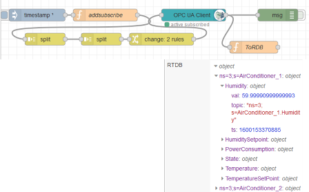

- [ ] зробіть розгортання потоку, переглядаючи та змінюючи значення змінних за допомогою OPC UA Client UaExpert перевірте, що у глобальному контексті "RTDB" дані оновлюються
- [ ] перегляньте та проаналізуйте вміст потоку

## 2. Знайомство з EcoStruxure Machine Advisor з точки зору замовника

https://ecostruxure-machine-advisor.se.app

**EcoStruxure Machine Advisor** - це хмарна платформа, спеціально розроблена для оптимізації відстеження даних, моніторингу та усунення несправностей для промислових машин (установок), розташованих у всьому світі.

Платформа заснована на MS Azure Cloud і забезпечує наступну функціональність:

- Збір даних з машиною (установкою), за допомогою протоколів MQTT і HTTPs, або через завантаження файлів CSV
- відображення даних через приладові панелі (dashboard)
- обробка даних з використанням вбудованих додатків
- оповіщення при позаштатних ситуаціях (обрив зв'язку, вихід за межі, прогнозування поломки)
- можливість швидкого доступу до структури машини та необхідної документації
- забезпечення доступу з різними профілями користувачів за командами (адміністратори, розробники, персонал)
- можливість планування завдань (наприклад, обслуговування та ремонт)

Вся зазначена функціональність зосереджується навколо машини (або установки). Кожна машина має означене географічне розташування, яке може задаватися стаціонарно, або визначатися за координатами, які машина передає на платформу (широта, довгота). По суті своій ця концепція подібна до "цифрового двійника", хоча і в дещо спрощеному варіанті.

У цьому практичному занятті EcoStruxure Machine Advisor використовується як приклад простої платформи контролю та керування активами IIoT. Machine Advisor поки що має обмежені можливості, а в тріал-варіанті обмежень функціонал.

У цій частині практичного заняття EcoStruxure Machine Advisor розглядається з точки зору кінцевого користувача (замовника).

### 2.2. Первое знакомство с Machine Advisor

- [ ] На странице "Before you start" ознакомьтесь с правилами, дайте согласие и нажмите `Start`
- [ ] На следующей странице активируйте опцию `Show Demo Organization`
- [ ] Появится страница с обзором парка подключенных машин (`FLEET overview`). Посмотрите следующие части экрана:

  - список размещений, в котором указаны географическое расположение машин, выделяя размещение оно показывается на карте 
  - список машин в выделенном месте а также их состояние 
  - кнопки перехода в отображение статической и динамической информации по машине

### 2.1. Реєстрація на Schneider Electric

- [ ] Зайдіть на сторінку реєстрації Schneider Electric, натиснувши "sign In" на сторінці https://ecostruxure-machine-advisor.se.app
- [ ] Якщо у Вас немає облікового запису, перейдіть за посиланням `Register here` і створіть безкоштовний обліковий запис
- [ ] На пошту прийде повідомлення про реєстрацію, перейдіть за посиланням та увійдіть до системи

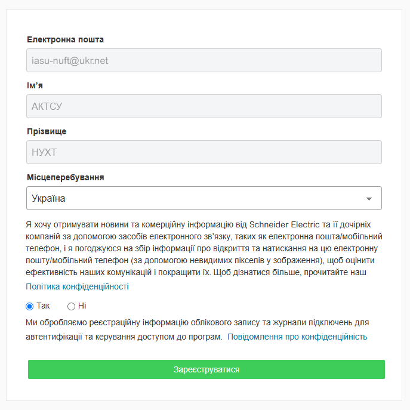

### 2.2. Перше знайомство з Machine Advisor

- [ ] На сторінці "Before you start" ознайомтеся з правилами, дайте згоду та натисніть `Start`
- [ ] На наступній сторінці активуйте опцію `Show Demo Organization`
- [ ] З'явиться сторінка з оглядом парку підключених машин (FLEET overview). Перегляньте наступні частини екрана:

 - список розміщень, в якому вказано географічне розташування машин, виділяючи розміщення воно відображається на карті
 - список машин у виділеному місці та їх стан
 - кнопки переходу у відображення статичної та динамічної інформації по машині

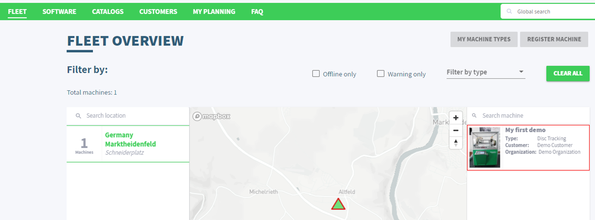

- [ ] используя [F.A.Q](https://faq.machine-advisor.com/machine-configuration/) определите состояние существующей машины

### 2.3. Просмотр статической информации (track) о машине

Доступ к нужной машине можно сделать как выбрав ее с перечня, так и через QR-код, который генерируется автоматически и доступный на сайте  (можно распечатать и прикрепить к машине). 

Статическая информация (**track**) включает в себя всю необходимую документацию на машину и компоненты (устройства) машины. Разработчик может скомбинировать техническую структуру, в которой указать компоненты (устройства) и типы соединений (сети). Типы устройств (компонентов) доступны в библиотеке, которая расширяется всеми пользователями. Каждое устройство имеет имя, производителя, отображение и описание.  

Документацию для всей машины разработчик загружает непосредственно на платформу. Это могут быть файлы PDF или видео формата MP4. Таким образом, обслуживающий персонал, выбрав необходимую машину будет иметь возможность быстро доступаться к необходимой документации. 

- [ ] Выделите машину в списке ("My first demo") и нажмите Track
- [ ] В появившемся окне найдите и посмотрите следующую информацию:
  - [ ] QR-код с ссылкой на эту страницу
  - [ ] архитектуру машины:
    - [ ] в виде архитектуры
    - [ ] в виде перечня компонентов (выбор через пиктограмму "Bill of material" внизу окна )  
    - [ ] в виде фотографии (пиктограмма "Architecture Picture")
  - [ ] в TASKS MANAGEMENT перечень задач, которые нужно сделать (open task) и сделаны (complete)
  - [ ] журнал действий (Activity), проделанных за указанный месяц
  - [ ] перечень доступных документов по машине и их содержимое 

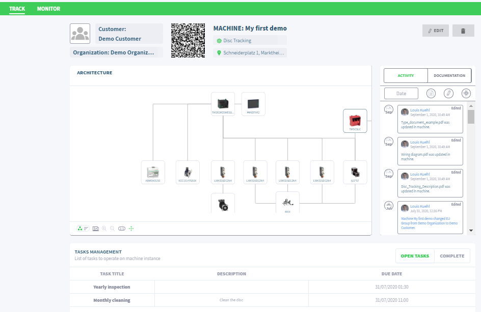

### 2.4. Просмотр динамической информации (Monitor) о машине

Динамическая информация (реального времени) доступна через вкладку **Monitor**. В основном информация предоставляется через Dashboard, который настраивается простым перетаскиванием и заданием свойств. С помощью виджетов можно представить информацию и в графическом и в текстовом виде. При необходимости можно посмотреть историю в виде трендов и таблиц для нужной точки ввода/вывода.

- [ ] Перейдите на вкладку Monitor
- [ ] Посмотрите и осмыслите предназначение каждого виджета на всех приборных панелях Dashboard (General, Machine Data, Energy Data)
- [ ] На панели "Machine Data" посмотрите детали информации с виджета "Throws good" с использованием кнопки "more>"

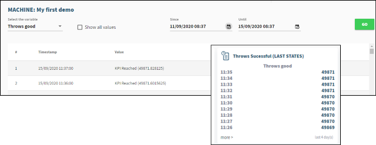

- [ ] На панели "Machine Data" посмотрите детали информации с виджета с трендами температуры использованием кнопки "Explore>":
  - [ ] выберите три переменных
  - [ ] укажите диапазон за последнюю неделю

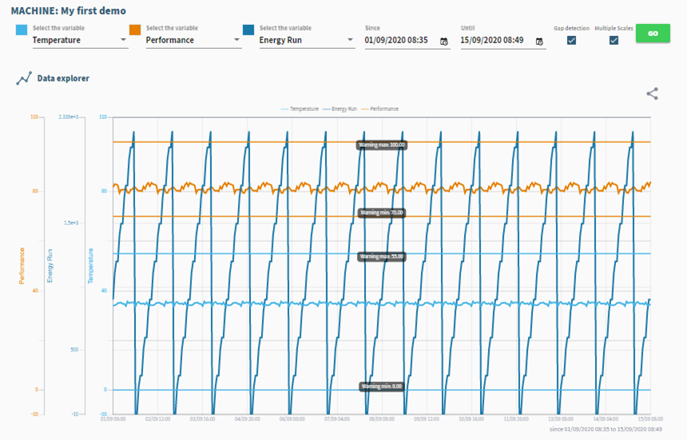

- [ ] Перейдите на панель "History", выберите одну с переменных, например OEE  и посмотрите изменение ее значения за последнюю неделю
- [ ] Перейдите на панель "Graph", его функциональность аналогична виджету с трендами

### 2.5. Просмотр информации о пользователе

- [ ] Перейдите на настройки своего аккаунта, кликнув по пиктограме с Вашим именем
- [ ] При желании измените свои данные, например свою фотографию

## 3. Работа с EcoStruxure Machine Advisor в режиме разработки

В этой части практического занятия необходимо перейти в режим разработчика и разработать цифрового двойника для своей машины.

### 3.1. Переключение на другую организацию

В предыдущей части занятия Вы работали как оператор в организации "Demo Organization", где была возможность просмотреть и пользоваться информацией. Для создания собственной машины, необходимо переключиться на свою организацию  

- [ ]  Переключитесь на свою организацию

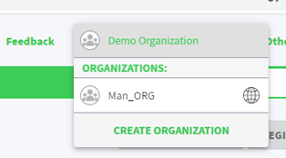

### 3.2. Создание типа машины

- [ ] Перейдите на главное окно "FLEET"
- [ ] Перейдите на "My Machine Types"
- [ ] С помощью кнопки "+" добавьте новый тип "Conditioner"
- [ ] С помощью кнопки "ViewType" перейдите на определение типа устройства
- [ ] Измените изображение, например на [это](https://drive.google.com/file/d/1vvjdmJVLrEavJlc4XL5EEg722CpIqEjw/view?usp=sharing)
- [ ] В окне "Architecture" перейдите в режим "Edit"
- [ ] Переключитесь редактор архитектуры в режим "Bill of Material" и добавьте:
  - один ПЛК, например M251
  - операторскую панель, например HMIGTO
  - ПЧ, например ATV32    

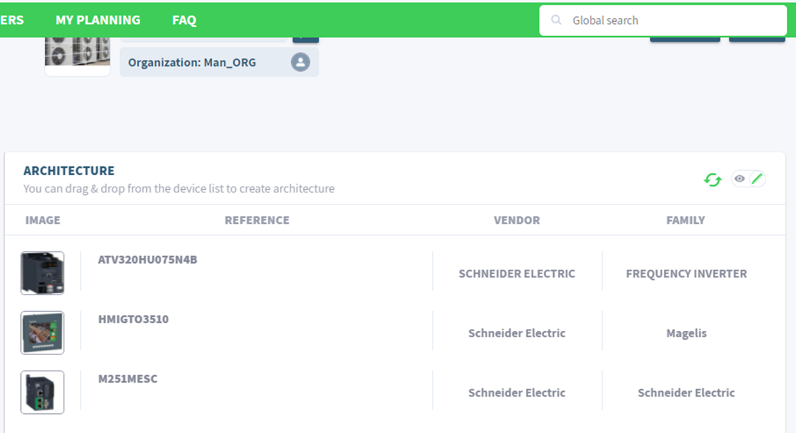

- [ ] переключите редактор архитектуры в режим "Architecture", потом "Selection Tool", соедините устройства, как показано на рисунке: связь межу устройствами можно выбрать Modbus TCP/IP и Modbus

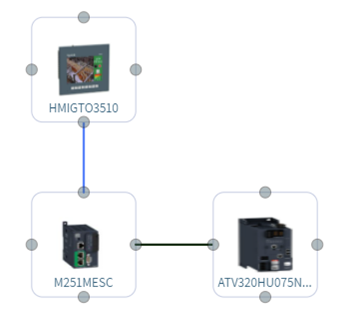

- [ ] переключитесь в режим "Architecture Picture" и через меню Upload Picture загрузите туда [рисунок](https://drive.google.com/file/d/1na6hAOB95WfMuPHrNqcS_3yKeNflj0Up/view?usp=sharing) и нажмите "Save" (изображение карандаша).

### 3.3. Добавление документации на машину

- [ ] Через панель "Documetation" добавьте один любой файл pdf
- [ ] Выделите документ и прикрепите к нему тег "ATV", теперь документацию можно фильтровать по указанному тегу

### 3.4. Создание задачи на обслуживание

- [ ] Создайте задачу (тип) на обслуживание машины "Create Task" с именем "поменять фильтры" и "общий осмотр"

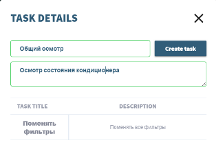

### 3.5. Регистрация экземпляра машины

- [ ] Зайдите в "FLEET->Register Machine"
- [ ] Создайте две машины `Conditioner_1` и `Conditioner_2`:
  - [ ] тип `Conditioner`
  - [ ] customer - собственный
  - [ ] две различные локации 

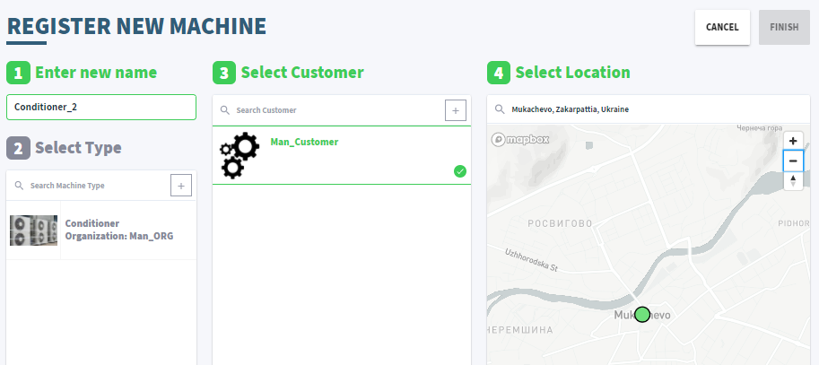

### 3.6. Редактирование экземпляра

- [ ] Зайдите в настройки TRACK одного с созданных экземпляров
- [ ] Поменяйте в экземпляра архитектуру, например сеть между устройствами
- [ ] Укажите дату следующего обслуживания  в "DUE DATE" для осмотра состояния кондиционера 
- [ ] Подтвердите проведение осмотра  путем активирования опции (галочки), задание перейдет в состояние "COMPLETED" 

### 3.7. Обновление профиля пользователя

Для использования функций обмена данными с уровнем Edge необходимо обновить профиль пользователя. После этого дается 3 месяца пробного использования функций связи и отображения динамических данных.

- [ ] Перейдите в настройки профиля пользователя
- [ ] Перейдите на закладку "Go digital"
- [ ] Нажмите "Upgrafe You Profile"
- [ ] Повторно зайдите в систему
- [ ] Заполните дополнительные поля
- [ ] Перейдите в настройки профиля пользователя
- [ ] Зайдите на вкладку "MyLicenses" и нажмите "Start Trial", в появившемся окне подтвердите свой выбор
- [ ]  Зайдите в настройки организации ("Manage Organiation") и укажите себя как покупателя лицензии ("SET ME AS THE PURCHASER")  

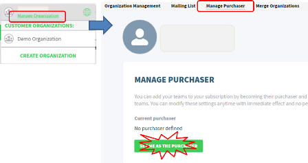

### 3.8. Активация подключение данных 

- [ ] Выберите машину "Conditioner_1"
- [ ] Перейдите в режим "Monitor"
- [ ] Выберите режим "Connect your machine"
- [ ] Выберите лицензию "Subscription"

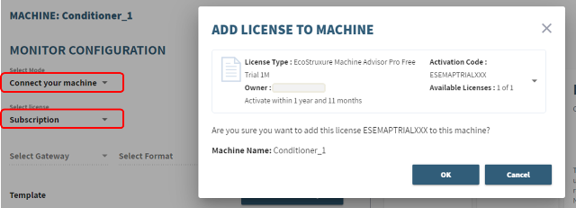

### 3.9. Настройка формата и источника подключения данных 

- [ ] На странице "Manage Dashboard" в настройках "Config" определите формат и источник обмена:
  - [ ] Gateway - `Custom`
  - [ ] формат обмена (Select format) - `Charlie`
  - [ ] протокол (Select Transport) - `HTTPs`

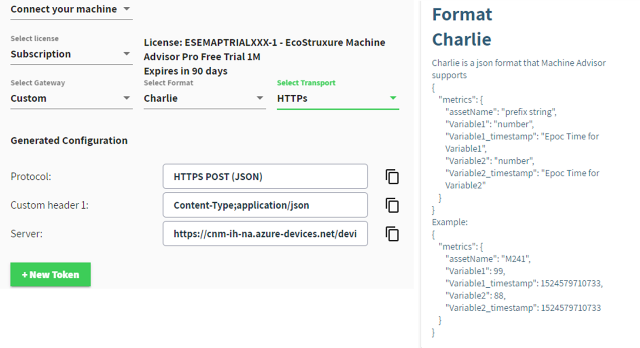

- [ ] на этой же странице найдите формат отображения Charlie

### 3.10. Создание Token 

Для защиты подключения создается секретный маркер (Token), который передается вместе с сообщением. Он создается на определенный период. Сообщение принимаются только при правильном Token. 

- [ ] На странице "Manage Dashboard" в настройках "Config" создайте маркер "New Token" и скопируйте его в текстовый файл для дальнейшего использования 

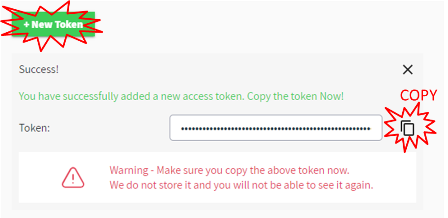

- [ ] нажмите крестик для закрытия окна отображения генерации маркера

### 3.11. Создание программы в Node-RED для отправки данных 

- [ ] В Node-RED создайте новый поток (вкладку)
- [ ] Создайте программу

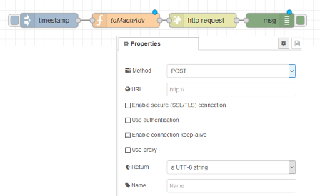

- [ ] Скопируйте указанный ниже код в функцию

```js
msg.url = "тут должен быть URL c настройки Server";
msg.headers = {
	"Content-Type": "application/json",
	"Authorization": "Authorization;SharedAccessSignature .. тут записвается выданный Вам маркер"
};
msg.headers.Authorization=msg.headers.Authorization.replace(/^.*SharedAccessSignature/,"SharedAccessSignature");

let RTDB = global.get ("RTDB");
let j=0;
//заполняем сообщения для каждого кондиционера в формате Charlie
for (const assetname in RTDB)
{
    //имя asset можно было бы взять с имени кондиционера, но оно очень долгое
    let assetname_s = "A" + (++j);
    let ob = {"metrics": {"assetName" : assetname_s}};
    let asset = RTDB[assetname];
    for (const tag in asset){
        ob.metrics[tag] = asset[tag].val;
        ob.metrics[tag + "_timestamp"] =asset[tag].ts;
    }
    msg.payload = ob;
    node.send (msg);
}
```

- [ ] замените в программе значение свойства `msg.url` на значение с поля Server

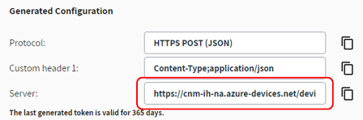

- [ ] замените в программе значение свойства "Authorization" на сохраненный ранее маркер 
- [ ] Сделайте разворачивание потока

### 3.12. Проверка отправки данных 

- [ ] Инициируйте поток для отправки данных
- [ ] проконтролируйте, что нет ошибок в окне отладки
- [ ] на платформе перейдите на вкладку Values и посмотрите полученные значения 

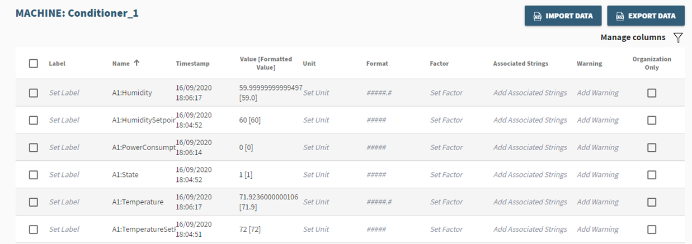

- [ ] для температур добавьте:
  - [ ] единицы измерения (Unit - °С),
  - [ ] формат `00.00` 
  - [ ] границы для Warning 
- [ ] измените программу в Node-RED так, чтобы сообщение отправлялось каждые 10 секунд
- [ ] На вкладках "Hystory" и "Graph" посмотрите как менялись значения переменных во времени 

### 3.13. Создание Dashboard 

- [ ] Нажмите "Managed Dashboard"
- [ ] Создайте Dashboard 
- [ ] Используя "Add Widget" разместите по одному виджету для каждого типа
- [ ] Настройте элементы как показано с следующих пунктах

#### 3.13.1. Value

- [ ] Настройте отображение всех значений

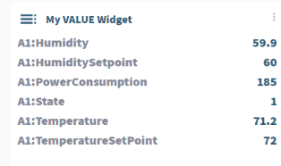

#### 3.13.2. GAUGE/Thermometer 

- [ ] Отобразите значение температуры, настройте границы для изменения цвета шкалы

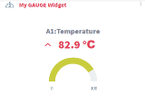

- [ ] С помощью OPC UA Client измените задание температуры `AirConditioner_1.TemperatureSetPoint` в такое значение, чтобы сработал Warning

#### 3.13.3. STATS

- [ ] Отобразите статистику по температуре за последний день 

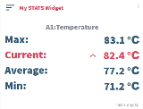

#### 3.13.4. DOUGHNUT/PROGRESSION BAR

- [ ] Отобразите 4-ре любые переменные

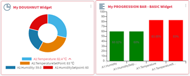

#### 3.13.5. PROGRESSION BAR - COMPARE

- [ ] Отобразите текущие и заданные температуры и влажности

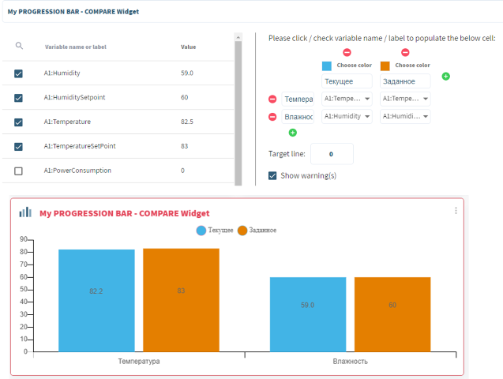

#### 3.13.6. Pareto  

- [ ] Отобразите текущие и заданные температуры и влажности

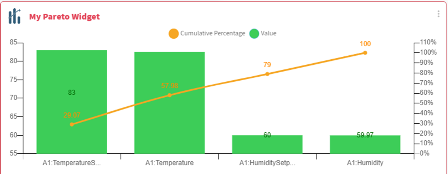

#### 3.13.7. TREND 

- [ ] Отобразите текущие значения температуры и влажности

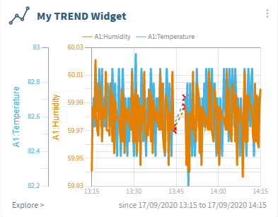

#### 3.13.8. LAST STATES

- [ ] Отобразите текущие значения влажности за последние сутки

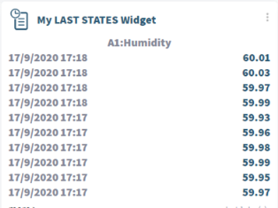

#### 3.13.9.  Traffic light 

- [ ] Отобразите текущие значения температуры 

#### 3.13.10. Text 

- [ ] Отобразите какой-то текст в формате Markdown

#### 3.13.11. Single Photo 

- [ ] Отобразите какой-то рисунок и выведите значение некоторых переменных 

### 3.14. Создание Application

Кроме отображения данных на приборных панелях, платформа предоставляет использовать приложения. Среди приложений, описанных в документации (вернее в FAQ) есть "Health Application", но оно не доступно в FREE подписке. Согласно документации, это приложение собирает данные для обучения, после чего анализирует данные реального времени, обнаруживает аномалии и сообщает об этом через почту или СМС. После чего пользователь может сделать анализ трендов и написать свой отзыв об аномалии. Для процесса обучения приложения нужно минимум две недели. 

Другие доступные приложения представлены калькуляционными, которые выполняют арифметические и статистические преобразования, и функции оповещения по электронной почте и SMS. 

- [ ] Перейдите на раздел "Application"
- [ ] Добавьте функцию Agregation с названием "Average" для нескольких переменных с функцией расчета среднего значения(Average)
- [ ] Значения будут доступны через сутки

### 3.15. Добавление пользователя в организацию разработчика

- [ ] Перейдите в `Manage Organization`
- [ ] Добавьте пользователя pupena_san@ukr.net 
- [ ] Попросите преподавателя чтобы он подтвердил приглашение

### 3.16. Подтверждение добавления пользователя в организацию разработчика

- [ ] После подтверждения запроса пользователя обновите страничку `Manage Organization`

Теперь новый пользователь может участвовать как разработчик

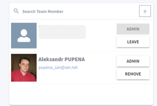

### 3.17. Добавления пользователя в организацию заказчика

- [ ] Удалите добавленного пользователя с разработки
- [ ] Перейдите на вкладку Customers и добавьте туда пользователя pupena_san@ukr.net 
- [ ] Попросите преподавателя чтобы он подтвердил приглашение
- [ ] После подтверждения запроса пользователя обновите страничку

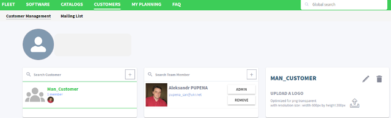

Теперь пользователь сможет только просматривать Dashboard

